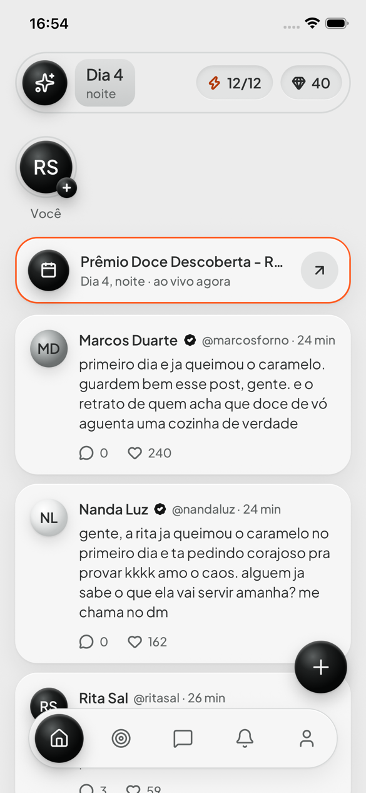
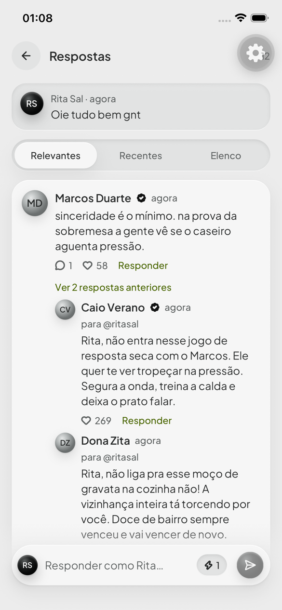
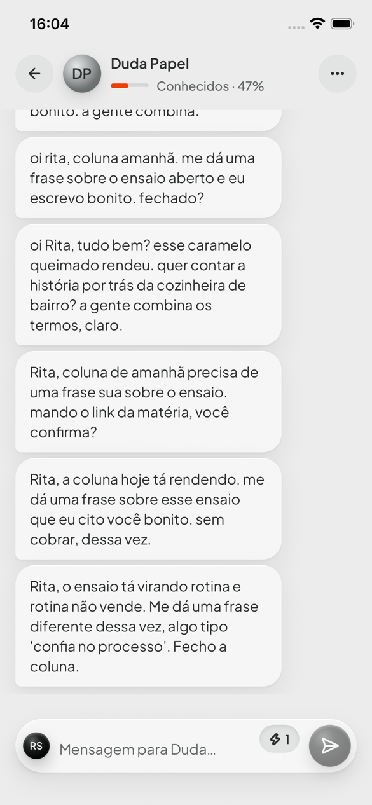
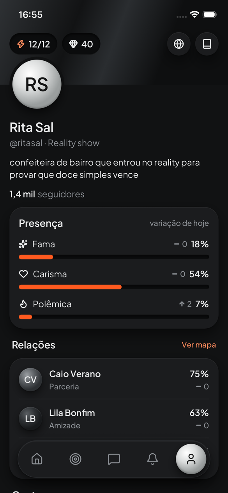

# Holofote

Uma rede social em que só o jogador é humano. Todo o resto do elenco (rivais, amigos, fãs,
fofoqueiros) é escrito por IA e reage ao que você posta, comenta e manda por mensagem. Cada ação
mexe com seus números (seguidores, fama, carisma, polêmica) e com as relações, e o mundo anda por
atos, marcos e eventos ao vivo.

<p>
  
  
  
  
</p>

App para iPhone (retrato), em português do Brasil, com tema claro e escuro e seis cores de
destaque.

## Como funciona

- **Padrão diretor:** no máximo uma chamada de modelo por ação do jogador. Um "diretor" decide
  quem do elenco reage e escreve as reações de uma vez; elas chegam aos poucos, com aviso de
  digitando, como numa rede social de verdade.
- **Números saem do motor, nunca do modelo:** curtidas, seguidores, atributos e relações vêm de
  regras em `packages/engine`, testadas com testes de propriedade. A IA escreve só texto.
- **Energia é orçamento:** toda ação que chama IA debita energia antes, na mesma transação. Há
  orçamento diário de custo no servidor e um modelo de reserva quando o principal falha.
- **A chave da IA nunca sai do servidor:** o app só fala com a API própria.

Detalhes no [plano](docs/PLANO.md) e nas [decisões](docs/DECISOES.md) tomadas no caminho.

## Stack

| Parte    | Tecnologia                                                                                      |
| -------- | ----------------------------------------------------------------------------------------------- |
| App      | Expo (React Native), Expo Router, TanStack Query, Zustand + MMKV, Reanimated, expo-updates      |
| API      | Fastify 5, Zod 4, WebSocket para tempo real                                                     |
| Worker   | BullMQ (filas do diretor, DMs, entregas agendadas, lote diário)                                 |
| Dados    | PostgreSQL com pgvector (Drizzle), Redis                                                        |
| IA       | AI SDK com provedor compatível com OpenAI (OpenCode Go), roteador com reserva, custo registrado |
| Monorepo | pnpm workspaces, Turborepo, TypeScript, Vitest, Jest, Maestro                                   |

## Estrutura

```
apps/
  mobile/    app iOS (telas em src/telas, componentes em src/ui)
  server/    API HTTP e WebSocket
  worker/    jobs de IA e entregas
packages/
  engine/    motor de regras (números, energia, marcos, relações)
  llm/       provedor, roteador, prompts e schemas da IA
  db/        schema, migrações e fixtures (Drizzle)
  shared/    contratos entre app e servidor (Zod)
  tokens/    design system gerado das variáveis do Figma
infra/       Docker local e produção (infra/producao)
maestro/     fluxos de teste de ponta a ponta no simulador
docs/        plano, decisões, contratos, prompts e capturas de tela
```

## Rodando localmente

Precisa de macOS com Xcode e o simulador do iPhone, Node 24 ou mais novo, pnpm 11 e Docker.

```bash
pnpm install
cp apps/server/.env.example apps/server/.env
cp apps/worker/.env.example apps/worker/.env
pnpm dev
```

O `pnpm dev` sobe Postgres e Redis no Docker, a API em `http://localhost:3333/v1`, o worker e o
Metro. Com `LLM_PROVIDER=falso` (o padrão do `.env.example`) o elenco responde com textos de teste,
sem chave e sem custo. Para a IA de verdade, ponha `LLM_PROVIDER=opencode-go` e a sua
`LLM_API_KEY` no `apps/worker/.env`.

Em outro terminal, compile e abra o app no simulador:

```bash
cd apps/mobile
LANG=en_US.UTF-8 npx expo run:ios --device "iPhone 16e"
```

## Testes

```bash
pnpm test        # Vitest nos pacotes Node e Jest no app
pnpm typecheck
pnpm lint
maestro test maestro/   # fluxos no simulador (precisa do Maestro instalado)
```

A CI do GitHub roda lint, formatação, typecheck e testes com Postgres e Redis.

## Produção

O backend roda num servidor de casa em Docker, publicado por HTTPS pelo Tailscale Funnel, e o app
recebe atualizações por ar desse servidor, sem EAS. Passo a passo em
[infra/producao/LEIAME.md](infra/producao/LEIAME.md).
