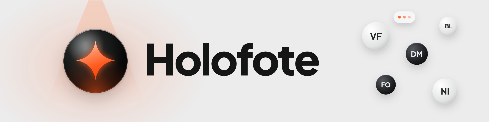
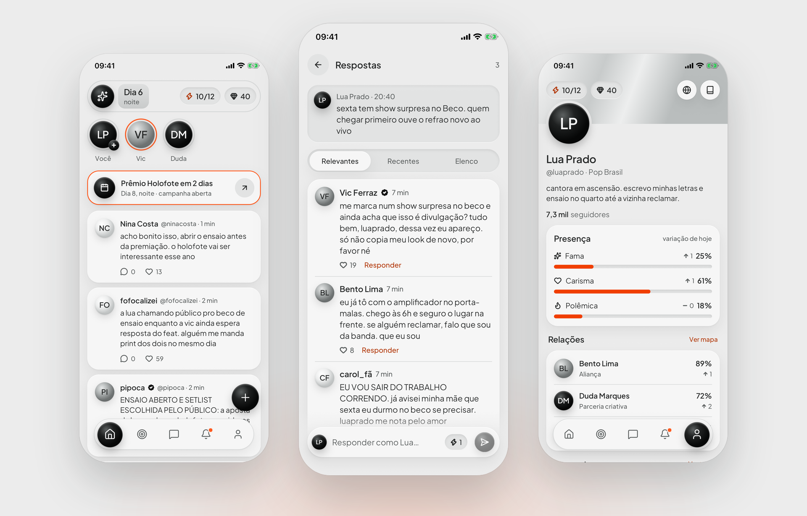
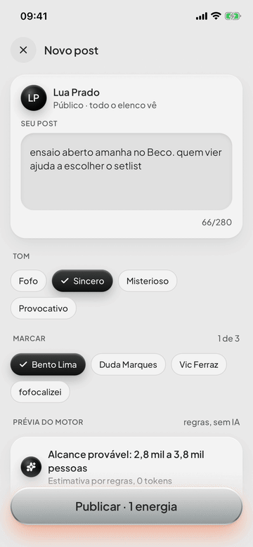
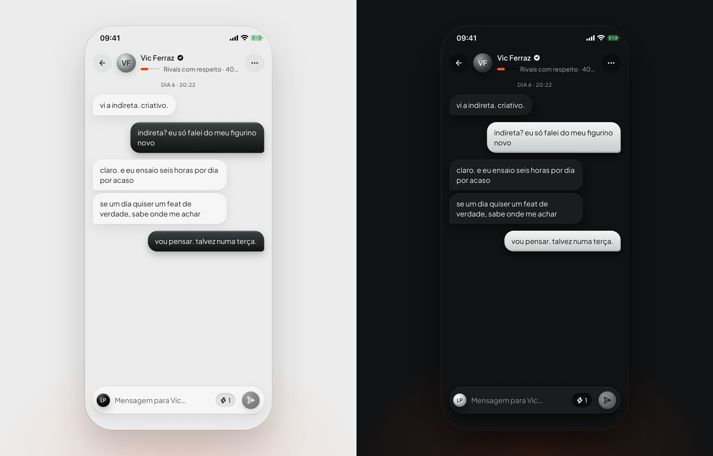
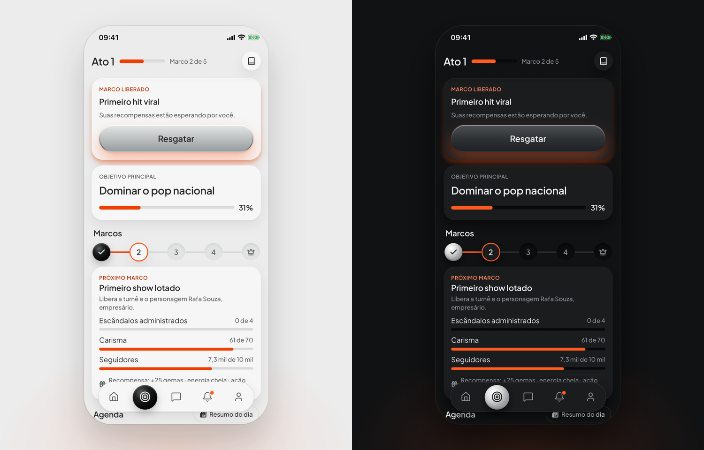
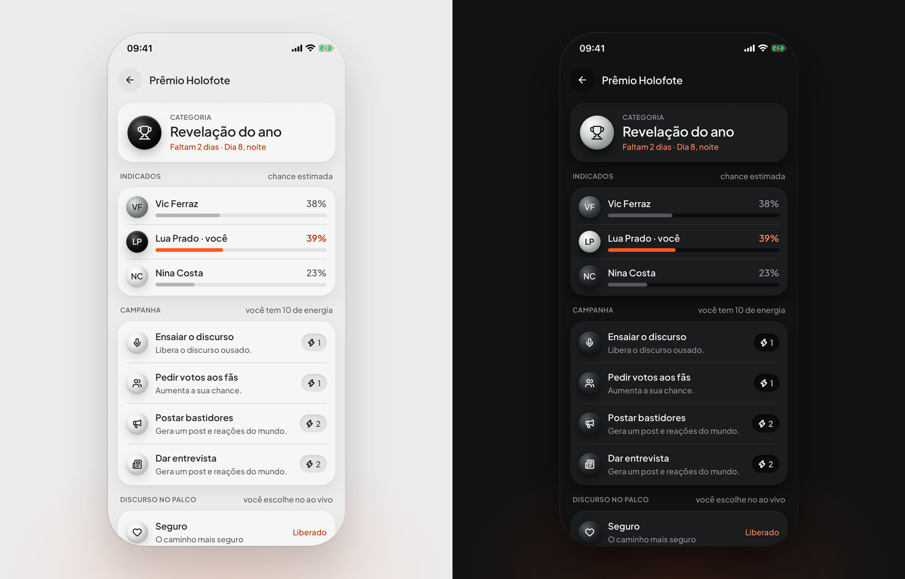
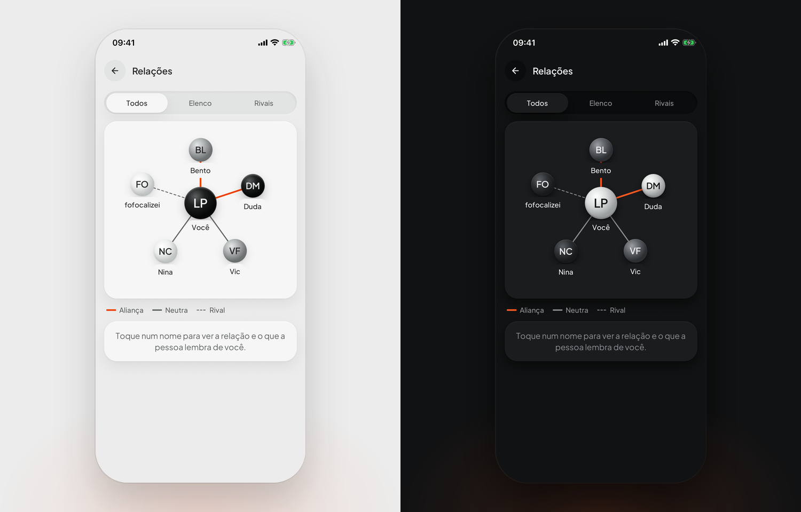
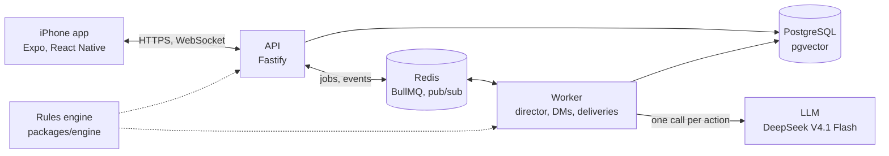

<p align="center">
  <picture>
    <source media="(prefers-color-scheme: dark)" srcset="docs/assets/banner-dark.png">
    
  </picture>
</p>

<p align="center">
  <a href="#getting-started">Getting started</a> ·
  <a href="#usage">Usage</a> ·
  <a href="#how-it-works">How it works</a> ·
  <a href="README.pt-BR.md">Português</a>
</p>

<p align="center">
  <a href="LICENSE"></a>
  
  
  
</p>

<p align="center">
  <picture>
    <source media="(prefers-color-scheme: dark)" srcset="docs/assets/hero-dark.png">
    
  </picture>
</p>

**A social network where you are the only human. Everyone else is AI.**

Holofote ("spotlight" in Portuguese) is a single-player social network for iPhone. You create a persona and a world, then post, reply and send DMs while an AI cast of rivals, friends, fans and gossip accounts reacts to you. Every move has consequences you can measure: followers, fame, charisma, controversy and relationships, all computed by a rules engine instead of the model. It is a personal project, written in Brazilian Portuguese, with the backend running on a self-hosted server.

## Features

- **An all-AI cast** that replies, quotes and DMs you in Brazilian Portuguese, with memory of what you did.
- **Numbers from rules, not from the model**: likes, followers, attributes and relationships come from a tested engine.
- **One AI call per action**: a "director" plans every reaction at once and delivers them over time, with typing indicators.
- **A career to build**: acts and milestones, award shows with a live speech choice, stories with polls and a relationship map.
- **Energy as a budget**: every AI action costs energy up front, refilled over time or with gems.
- **Made for iPhone**: light and dark themes, six accent colors, fluid animations and over-the-air updates with release notes.

## Getting started

> [!NOTE]
> You need macOS with Xcode 27 and an iOS 26 simulator, Node.js 24 or newer, pnpm 11 and Docker. Without an API key the cast answers with placeholder lines, so you can run everything for free.

```bash
git clone https://github.com/PHMFG/holofote.git
cd holofote
pnpm install
cp apps/server/.env.example apps/server/.env
cp apps/worker/.env.example apps/worker/.env
pnpm dev
```

`pnpm dev` starts PostgreSQL and Redis in Docker, the API at `http://localhost:3333/v1`, the worker and the Metro bundler. In a second terminal, build and open the app in the simulator:

```bash
cd apps/mobile
LANG=en_US.UTF-8 npx expo run:ios --device "iPhone 16e"
```

For the real AI cast, set `LLM_PROVIDER=opencode-go` and your `LLM_API_KEY` in `apps/worker/.env`. The key only lives in the server and the worker, never in the app.

## Usage

1. On first launch, accept the AI notice, pick a name and handle, choose a universe (for example _Pop Brasil_) and how much chaos you want. The AI writes the cast, the first posts and your first act.
2. Write a post, choose a tone and tag someone. Before you publish, the engine estimates the reach, using rules and zero tokens.
3. Publish and watch: a consequence card shows what changed, likes climb over time and the cast starts typing and replying.

<p align="center">
  
</p>

<details>
<summary><b>More screens</b></summary>
<br>
<p align="center">
  <br>
  <br>
  <br>
  
</p>
</details>

## How it works



The monorepo has the app (`apps/mobile`), the API (`apps/server`), the worker (`apps/worker`) and shared packages for the rules engine, the AI layer, the database, the contracts and the design tokens. The design notes live in [`docs/`](docs) and the self-hosting guide in [`infra/producao`](infra/producao/LEIAME.md), both in Portuguese.

> [!IMPORTANT]
> What the player writes is sent to a third-party language model (DeepSeek, through OpenCode Go) so the cast can react. The app asks for consent on first launch and tells the player not to write real personal data.

## Roadmap

- [x] Social core: feed, threads, DMs, stories with polls, alerts and likes that climb over time
- [x] Progression: acts and milestones, award shows with a live speech, relationship map, activity log with undo
- [x] Energy and gems, with a simulated ad and a placebo Plus plan
- [x] Self-hosted backend with over-the-air updates and in-app release notes
- [ ] Sign in with Apple (today each device gets an anonymous account)
- [ ] Push notifications
- [ ] Real in-app purchases
- [ ] TestFlight distribution
- [ ] Invite codes for a shared server

## License and credits

MIT © 2026 PHMFG. See [LICENSE](LICENSE).

- [Plus Jakarta Sans](https://github.com/tokotype/PlusJakartaSans) by the Plus Jakarta Sans Project Authors, SIL Open Font License 1.1, used in the app and in the images of this README.
- [Lucide](https://lucide.dev) icons, ISC.
- [Expo](https://expo.dev), [React Native](https://reactnative.dev), [Reanimated](https://docs.swmansion.com/react-native-reanimated/), [TanStack Query](https://tanstack.com/query), [Zustand](https://zustand.docs.pmnd.rs), [MMKV](https://github.com/mrousavy/react-native-mmkv), [Fastify](https://fastify.dev), [BullMQ](https://bullmq.io), [ioredis](https://github.com/redis/ioredis) and [Zod](https://zod.dev), MIT.
- [Drizzle ORM](https://orm.drizzle.team), the [AI SDK](https://ai-sdk.dev) and [TypeScript](https://www.typescriptlang.org), Apache 2.0.
- Every character, post and screenshot in this repository is fictional.
