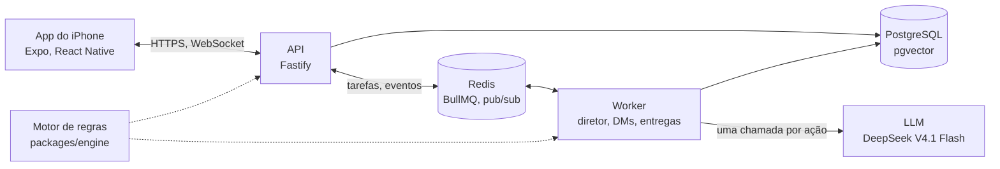

<p align="center">
  <picture>
    <source media="(prefers-color-scheme: dark)" srcset="docs/assets/banner-dark.png">
    
  </picture>
</p>

<p align="center">
  <a href="#como-rodar">Como rodar</a> ·
  <a href="#como-usar">Como usar</a> ·
  <a href="#como-funciona">Como funciona</a> ·
  <a href="README.md">English</a>
</p>

<p align="center">
  <a href="LICENSE"></a>
  
  
  
</p>

<p align="center">
  <picture>
    <source media="(prefers-color-scheme: dark)" srcset="docs/assets/hero-dark.png">
    
  </picture>
</p>

**Uma rede social em que só você é humano. O resto do elenco é IA.**

O Holofote é uma rede social de um jogador só, para iPhone. Você cria uma persona e um mundo e passa a postar, responder e mandar DMs enquanto um elenco de IA (rivais, amigos, fãs e perfis de fofoca) reage a você. Cada movimento tem consequências que dá para medir: seguidores, fama, carisma, polêmica e relações, todos calculados por um motor de regras, não pelo modelo. É um projeto pessoal, escrito em português do Brasil, com o backend rodando num servidor próprio.

## Recursos

- **Elenco todo de IA**, que responde, cita e manda DM em português do Brasil, lembrando do que você fez.
- **Números das regras, não do modelo**: curtidas, seguidores, atributos e relações saem de um motor testado.
- **Uma chamada de IA por ação**: um "diretor" planeja todas as reações de uma vez e as entrega aos poucos, com aviso de digitando.
- **Uma carreira para construir**: atos e marcos, premiações com discurso ao vivo, histórias com enquete e mapa de relações.
- **Energia como orçamento**: toda ação com IA gasta energia antes, que volta com o tempo ou com gemas.
- **Feito para iPhone**: temas claro e escuro, seis cores de destaque, animações fluidas e atualizações por ar com notas de versão.

## Como rodar

> [!NOTE]
> Você precisa de macOS com Xcode 27 e um simulador de iOS 26, Node.js 24 ou mais novo, pnpm 11 e Docker. Sem chave de API, o elenco responde com textos de teste, então dá para rodar tudo de graça.

```bash
git clone https://github.com/PHMFG/holofote.git
cd holofote
pnpm install
cp apps/server/.env.example apps/server/.env
cp apps/worker/.env.example apps/worker/.env
pnpm dev
```

O `pnpm dev` sobe o PostgreSQL e o Redis no Docker, a API em `http://localhost:3333/v1`, o worker e o Metro. Em outro terminal, compile e abra o app no simulador:

```bash
cd apps/mobile
LANG=en_US.UTF-8 npx expo run:ios --device "iPhone 16e"
```

Para o elenco de IA de verdade, ponha `LLM_PROVIDER=opencode-go` e a sua `LLM_API_KEY` no `apps/worker/.env`. A chave fica só no servidor e no worker, nunca no app.

## Como usar

1. Na primeira abertura, aceite o aviso sobre a IA, escolha nome e arroba, um universo (por exemplo, *Pop Brasil*) e quanto caos você quer. A IA escreve o elenco, os primeiros posts e o seu primeiro ato.
2. Escreva um post, escolha o tom e marque alguém. Antes de publicar, o motor estima o alcance só com regras, sem gastar tokens.
3. Publique e acompanhe: um cartão mostra o que mudou, as curtidas sobem com o tempo e o elenco começa a digitar e responder.

<p align="center">
  
</p>

<details>
<summary><b>Mais telas</b></summary>
<br>
<p align="center">
  <br>
  <br>
  <br>
  
</p>
</details>

## Como funciona



O monorepo tem o app (`apps/mobile`), a API (`apps/server`), o worker (`apps/worker`) e pacotes compartilhados para o motor de regras, a camada de IA, o banco, os contratos e os tokens de design. As notas de projeto ficam em [`docs/`](docs) e o guia para hospedar o servidor em [`infra/producao`](infra/producao/LEIAME.md).

> [!IMPORTANT]
> O que o jogador escreve vai para um modelo de linguagem de terceiros (DeepSeek, pelo OpenCode Go), para o elenco poder reagir. O app pede consentimento na primeira abertura e avisa para não escrever dados pessoais reais.

## Roadmap

- [x] Núcleo social: feed, conversas, DMs, histórias com enquete, alertas e curtidas que sobem com o tempo
- [x] Progressão: atos e marcos, premiações com discurso ao vivo, mapa de relações, registro com desfazer
- [x] Energia e gemas, com anúncio simulado e um plano Plus de mentira
- [x] Servidor próprio com atualizações por ar e notas de versão no app
- [ ] Entrar com a Apple (hoje cada aparelho ganha uma conta anônima)
- [ ] Notificações push
- [ ] Compras de verdade no app
- [ ] Distribuição pelo TestFlight
- [ ] Códigos de convite para um servidor compartilhado

## Licença e créditos

MIT © 2026 PHMFG. Veja a [LICENSE](LICENSE).

- [Plus Jakarta Sans](https://github.com/tokotype/PlusJakartaSans), dos Plus Jakarta Sans Project Authors, SIL Open Font License 1.1, usada no app e nas imagens deste README.
- Ícones [Lucide](https://lucide.dev), ISC.
- [Expo](https://expo.dev), [React Native](https://reactnative.dev), [Reanimated](https://docs.swmansion.com/react-native-reanimated/), [TanStack Query](https://tanstack.com/query), [Zustand](https://zustand.docs.pmnd.rs), [MMKV](https://github.com/mrousavy/react-native-mmkv), [Fastify](https://fastify.dev), [BullMQ](https://bullmq.io), [ioredis](https://github.com/redis/ioredis) e [Zod](https://zod.dev), MIT.
- [Drizzle ORM](https://orm.drizzle.team), o [AI SDK](https://ai-sdk.dev) e o [TypeScript](https://www.typescriptlang.org), Apache 2.0.
- Todos os personagens, posts e capturas deste repositório são fictícios.
